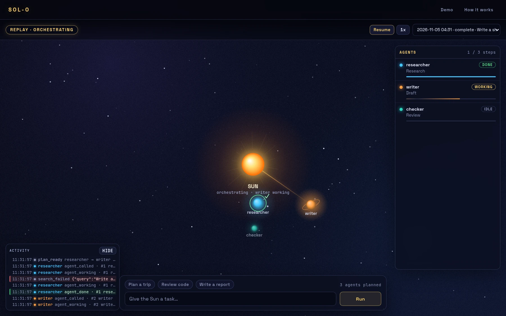

<p align="center">
  
</p>

# Sol-O

Automates customer inquiries: **researcher → writer → checker → logger → notifier** (Tavily search, SQLite audit log, Telegram delivery).



*Live run: each agent is a planet that appears when the Sun calls it, the roster tracks every agent's state and step progress, the activity feed streams timestamped backend events in each agent's colour, and the result card shows the final draft when the planets align.*

## Setup
```bash
cp .env.example .env && source .venv/bin/activate && pip install -r requirements.txt
```
Model: `BASE_URL` `API_KEY` `MODEL`. Tools: `TAVILY_API_KEY` `TELEGRAM_BOT_TOKEN` `TELEGRAM_CHAT_ID` `DRY_RUN` `TASK_DESCRIPTION`.
Safety: `LLM_TIMEOUT_SECONDS` `LLM_MAX_RETRIES` `TOOL_TIMEOUT_SECONDS` `RUN_TIMEOUT_SECONDS` `MAX_AGENTS` `REQUIRE_APPROVAL` `AUTO_APPROVE` `PENDING_TTL_HOURS` `MAX_INPUT_CHARS`.

## Run
```bash
uv run python -m app.cli "A customer asks: do you deliver on weekends?"
uv run python -m app.cli --file examples/inquiry.txt && uv run python -m app.cli "task" --plan
uv run uvicorn app.main:app
```

## Live UI
Open `http://127.0.0.1:8000/` while the API runs: a canvas solar system shows planets appearing, working, and finishing from real backend events over SSE (`GET /stream`). The command bar queues `POST /orchestrate`; the replay list reads `GET /runs/{id}/events` and can be paused, resumed, and played at 2x. A roster on the right mirrors every planned agent with its status and step progress, and the activity feed streams the same events with their recorded timestamps. When a run ends, the planets align and a result card shows the final draft, clarification, failure or rejection (click the status pill to reopen it). Click a planet or a roster row for that agent's role, task, duration and raw output; pending actions open a blocking approval gate that only a live run can decide. Below 768px the roster and feed fold into one tabbed sheet. `web/index.html` is self-contained with no build step; its only external request is one Google Fonts stylesheet, with a system fallback.

## Planet tools
Planets may ask the Sun to run a tool before answering: they return `{"tool_requests": [{"tool": ..., "args": {...}}]}`, the Sun executes it, records it in `tool_calls`, and feeds the result back for at most `MAX_TOOL_TURNS` tool turns per step (default 3). Every result keeps `tool`, `ok` and a `truncated` flag: an oversized result is trimmed to the result budget (a string is clipped, a list drops its trailing items and clips the last, a dict clips its longest text field) and is never replaced by a placeholder, while a requested `limit` is clamped into 1..`MAX_RESULT_ITEMS` before the tool runs.

| Tool | What it returns | Available to |
| --- | --- | --- |
| `kb_search` | matching chunks from `kb/**/*.md`/`*.txt` with their path | researcher, writer, checker |
| `fetch_url` | visible text of one public http(s) page (SSRF-guarded: globally routable addresses only, trimmed to the result budget) | researcher |
| `calc` | safe arithmetic and `days_between()`/`today()` results | writer, checker |
| `recall` | earlier runs **from the same `source`** only | researcher, writer |

The knowledge base is the committed `kb/` directory; edit it like any other content. `POST /inbound`'s `source` is the conversation key: recall never crosses sources, and an empty or `unknown` source disables it. Web search stays Sun-run before `researcher`.

## Approvals
`python -m app.cli --pending | --approve <id> | --reject <id>`; API `GET /pending`, `POST /pending/{id}/approve|reject`. `DRY_RUN=true` prints.

## Failures
`python -m app.cli --show <run_id>`; `GET /runs?status=failed`, `GET /runs/{run_id}` show status, `failed_at`, `failure.error_type` and every call.
Tests: `uv run pytest && uvx ruff check .`
