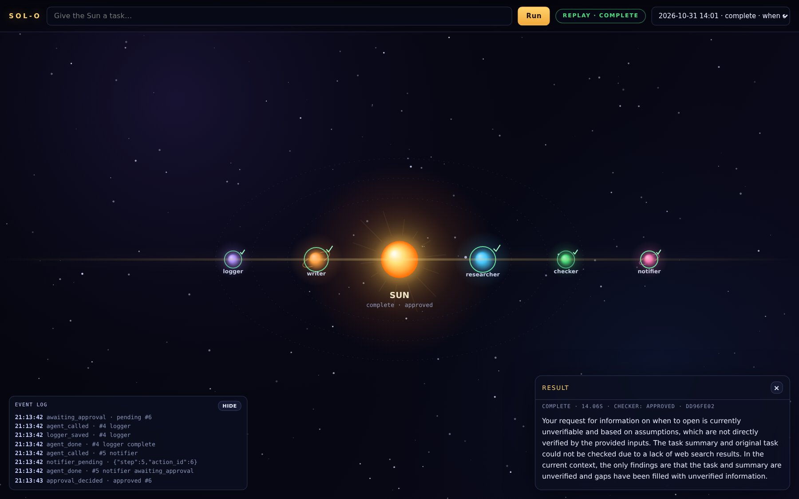

<p align="center">
  
</p>

# Sol-O

Automates customer inquiries: **researcher → writer → checker → logger → notifier** (Tavily search, SQLite audit log, Telegram delivery).



*Live run: each agent is a planet appearing on its orbit, the Sun reports the run status, the event log streams real backend events, and the result window shows the final draft.*

## Setup
```bash
cp .env.example .env && source .venv/bin/activate && pip install -r requirements.txt
```
Model: `BASE_URL` `API_KEY` `MODEL`. Tools: `TAVILY_API_KEY` `TELEGRAM_BOT_TOKEN` `TELEGRAM_CHAT_ID` `DRY_RUN` `TASK_DESCRIPTION`.
Safety: `LLM_TIMEOUT_SECONDS` `LLM_MAX_RETRIES` `TOOL_TIMEOUT_SECONDS` `RUN_TIMEOUT_SECONDS` `MAX_AGENTS` `REQUIRE_APPROVAL` `AUTO_APPROVE` `PENDING_TTL_HOURS` `MAX_INPUT_CHARS`.

## Run
```bash
uv run python -m app.cli "A customer asks: do you deliver on weekends?"
uv run python -m app.cli --file examples/inquiry.txt && uv run python -m app.cli "task" --plan
uv run uvicorn app.main:app
```

## Live UI
Open `http://127.0.0.1:8000/` while the API runs: a canvas solar system shows planets appearing, working, and finishing from real backend events over SSE (`GET /stream`). The Run button queues `POST /orchestrate`; the replay dropdown reads `GET /runs/{id}/events`. When a run ends, a result window shows the final draft, clarification, failure or rejection (click the status pill to reopen it). Click a planet for its raw JSON, or approve/reject pending actions in the sun's approval panel. `web/index.html` is self-contained; no build step or CDN.

## Approvals
`python -m app.cli --pending | --approve <id> | --reject <id>`; API `GET /pending`, `POST /pending/{id}/approve|reject`. `DRY_RUN=true` prints.

## Failures
`python -m app.cli --show <run_id>`; `GET /runs?status=failed`, `GET /runs/{run_id}` show status, `failed_at`, `failure.error_type` and every call.
Tests: `uv run pytest && uvx ruff check .`
